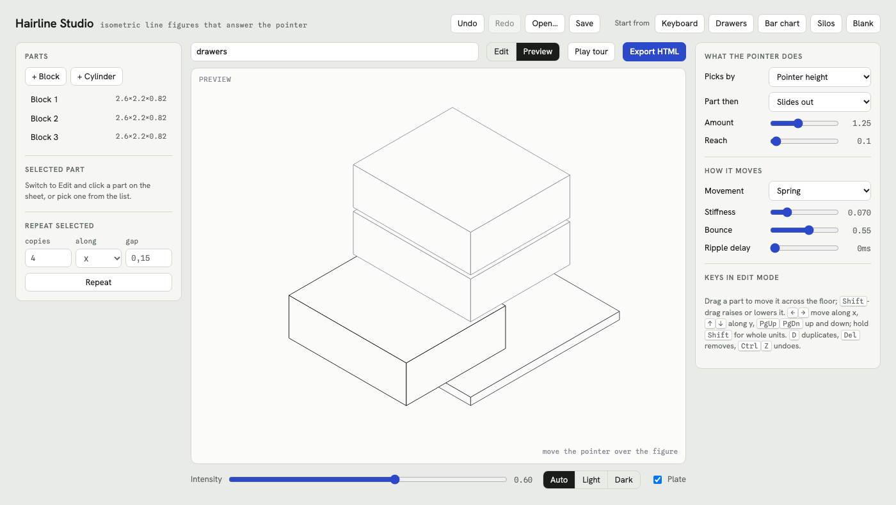

# Hairline Studio

[](https://github.com/zuppdev/hairline-studio/actions/workflows/ci.yml)
[](LICENSE)
[](https://zuppdev.github.io/hairline-studio/)

A visual editor for isometric line figures that answer the pointer. Build a figure out of blocks and cylinders, decide what the pointer does to it, preview it live, and export it as one HTML file with no dependencies.

**[Open the studio](https://zuppdev.github.io/hairline-studio/)** · Live examples: [keyboard](https://zuppdev.github.io/hairline-studio/examples/hairline-keyboard.html), [drawers](https://zuppdev.github.io/hairline-studio/examples/hairline-drawers.html), [bar chart](https://zuppdev.github.io/hairline-studio/examples/hairline-bar-chart.html), [silos](https://zuppdev.github.io/hairline-studio/examples/hairline-silos.html)



Inspired by [Hairline](https://hairline.lucasmarkes.com) by Lucas Marques. This project is an independent editor with its own small engine; it does not use or bundle Hairline's code and is not affiliated with it.

## Features

- **Edit visually.** Drag parts across the floor, Shift-drag to raise them, or type exact positions and sizes. Repeat a part into a row, turn a block into a cylinder, and mark parts as still.
- **Decide the motion.** Parts can be picked by distance from the pointer, by the pointer's height or by how far across it is, and then lift, sink, slide out, slide across or grow. Movement can snap, ease or spring, with an optional ripple delay.
- **Export one file.** The export is a single HTML page with the figure, an intensity slider, a theme switch and a guided tour. It runs offline in any modern browser.
- **Round-trip editing.** Projects save as `.hairline.json`, and the studio can open any HTML file it exported.
- **No build, no runtime dependencies.** The whole studio is [`index.html`](index.html).

## Run it locally

Nothing needs to be installed. Open `index.html` in a browser, or serve the folder:

```sh
npm start            # http://localhost:8765, needs Node 20+
# or
python3 -m http.server
```

## Make a figure

1. **Start from a preset**: Keyboard, Drawers, Bar chart, Silos or Blank.
2. **Edit**: switch to Edit and drag parts across the floor. Shift-drag raises or lowers a part. The left panel sets exact position and size, turns a block into a cylinder, and repeats a part into a row.
3. **Decide what the pointer does** in the right panel:
   - *Picks by*: distance from the pointer, the pointer's height, or how far across it is.
   - *Part then*: lifts, sinks, slides out, slides across or grows.
   - *Amount* and *Reach*: how far a part moves, and how far the effect spreads to its neighbours.
4. **Decide how it moves**: snap, ease or spring (with stiffness and bounce), plus a ripple delay so distant parts answer later.
5. **Preview** with the pointer, or press *Play tour* to watch it walk through every part.
6. **Export HTML** and download the file. Open it in any browser.

Untick *Moves with the pointer* on a part to keep it still, for a base or a rail.

### Keys in Edit mode

| Key | Action |
| --- | --- |
| Drag / Shift-drag | Move across the floor / up and down |
| Alt while dragging | Move without snapping to 0.05 |
| ← → | Move along x |
| ↑ ↓ | Move along y |
| PgUp PgDn | Move up and down |
| Shift + any of the above | Move in whole units |
| D | Duplicate |
| Delete | Remove |
| Esc | Deselect |
| Ctrl+Z / Ctrl+Shift+Z (⌘ on macOS) | Undo / redo |

### Saving

The studio keeps the current figure in the browser automatically. *Save* writes a `.hairline.json` project file, and *Open…* reads either a project file or an HTML file the studio exported, so an exported figure can always be edited again. Opened files are validated and out-of-range values are clamped to what the controls allow.

## The exported file

Each export is a single page holding the figure, an intensity slider from subtle to strong, a theme switch (auto, light, dark) and a play button that walks the tour. Colours come from CSS custom properties you can change:

```css
:root{
  --hl-plate: #fbfbf9; /* the fill every face sits on */
  --hl-hi:    #0e0f12; /* parts the pointer is moving */
  --hl-edge:  #3a3b42; /* the plate's outline */
  --hl-mid:   #8b8c95; /* every other stroke */
  --hl-lo:    #d7d8dc; /* the background grid in the studio */
  --hl-stroke: 0.9;    /* stroke width in CSS pixels at any size */
}
```

See [`examples/`](examples) for the four presets exported as-is.

## Embedding the engine

Every export contains the engine function `hairlineMount(svg, figure, options)`. It can be copied from an exported file and used on any page with an `<svg>` element.

```js
var figure = {
  name: 'two blocks',
  plate: true,
  motion: { pick: 'pointer', effect: 'lift', amount: 0.8, reach: 1.5, move: 'spring', stiff: 0.1, bounce: 0.5, ripple: 0 },
  parts: [
    { kind: 'box', x: 0, y: 0, z: 0, w: 1, d: 1, h: 0.6 },
    { kind: 'cyl', x: 1.3, y: 0, z: 0, w: 1, d: 1, h: 1.2, still: true }
  ]
};
var fig = hairlineMount(document.querySelector('svg'), figure, { intensity: 0.6 });
```

**Figure.** Parts are measured in grid units. `x`, `y` and `z` place the part's back-left-bottom corner; `w`, `d` and `h` are its width, depth and height. `kind` is `box` or `cyl`, and `still: true` keeps a part from moving.

| `motion` field | Values |
| --- | --- |
| `pick` | `pointer`, `height`, `across` |
| `effect` | `lift`, `sink`, `slideY`, `slideX`, `grow` |
| `amount` | 0.1 to 3 units |
| `reach` | 0.1 to 6 units |
| `move` | `snap`, `ease`, `spring` |
| `stiff`, `bounce` | spring stiffness (0.01 to 0.3) and bounce (0 to 0.95) |
| `ripple` | delay in milliseconds per unit of distance (0 to 200) |

**Options.** `intensity` (0 to 1, default 0.6), `mode` (`play` or `edit`), `onTourEnd()` and, in edit mode, `onPick(index, event)`.

**Returned object.**

| Method | Does |
| --- | --- |
| `update(figure, keepView)` | Replace the figure. Pass `keepView` to keep the current framing. |
| `setIntensity(v)` | Change the intensity, 0 to 1. |
| `setMode(mode)` | Switch between `play` and `edit`. |
| `setSelected(i)` | Highlight part `i` (-1 for none). |
| `tour()` / `stopTour()` / `touring()` | Start, stop and query the guided tour. `tour()` returns `false` when no part moves. |
| `order()` | The part indices in the order they were last drawn, back to front. |
| `destroy()` | Stop the animation loop. |

## How it works

Parts are stored as boxes in three dimensions. Each frame, the engine:

1. measures how far each part is from the pointer (in units, or by rank for height and across),
2. turns that into a target between 0 and 1 with a soft falloff,
3. moves each part toward its target by snapping, easing or a damped spring, on a fixed 60 Hz step so motion feels the same on any display,
4. projects every corner to the screen with the isometric formula `x' = (x − y)·cos 30°`, `y' = (x + y)·sin 30° − z`,
5. orders parts back to front: two parts whose outlines overlap on screen are ordered by the plane that separates them in space, and the result is sorted topologically,
6. redraws the SVG, skipping the work entirely when nothing has moved.

The studio previews with the same `hairlineMount` function it embeds in every export, so what you preview is what you ship. It honours `prefers-reduced-motion` by easing instead of bouncing.

## Development

The studio has no build step. Node is used only to run the tests and regenerate the examples.

```sh
npm install
npx playwright install     # browsers for the test suite
npm start                  # serve the studio at http://localhost:8765
npm test                   # Playwright tests in Chromium, Firefox and WebKit
npm run examples           # regenerate examples/ after changing the engine
```

| Path | Contents |
| --- | --- |
| `index.html` | The studio and the engine (`hairlineMount`). |
| `examples/` | The four presets, exported by `npm run examples`. |
| `tests/` | Engine, studio and example tests. |
| `scripts/` | A static dev server and the examples generator. |

Continuous integration runs the test suite and checks that `examples/` matches the engine on every push and pull request. Pushes to `main` that pass are deployed to GitHub Pages.

## Contributing

Bug reports, ideas and pull requests are welcome. See [CONTRIBUTING.md](CONTRIBUTING.md) to get started, and please follow the [Code of Conduct](CODE_OF_CONDUCT.md). Security issues should be reported privately as described in [SECURITY.md](SECURITY.md).

## License

[MIT](LICENSE)
